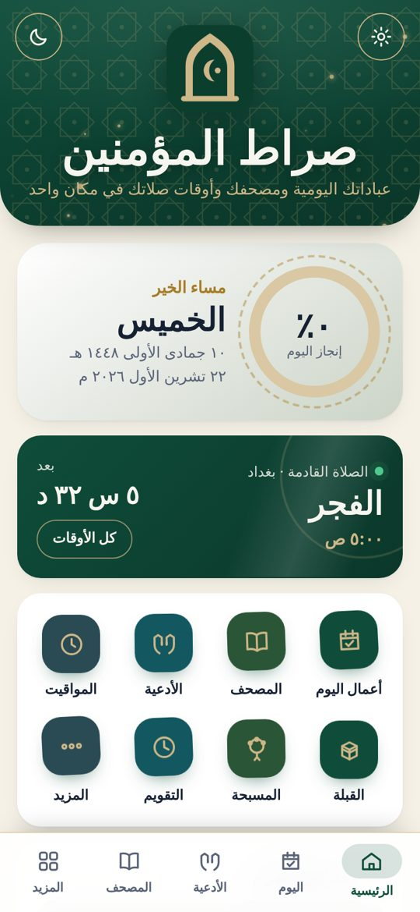
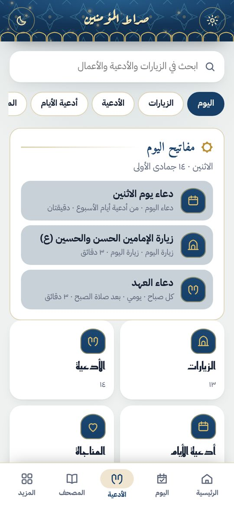
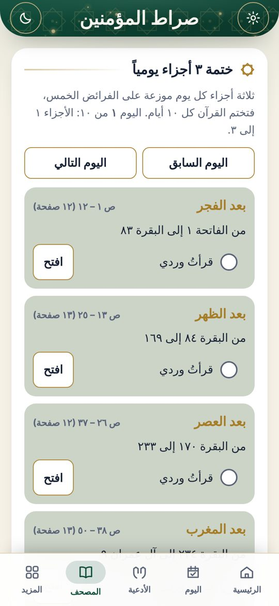
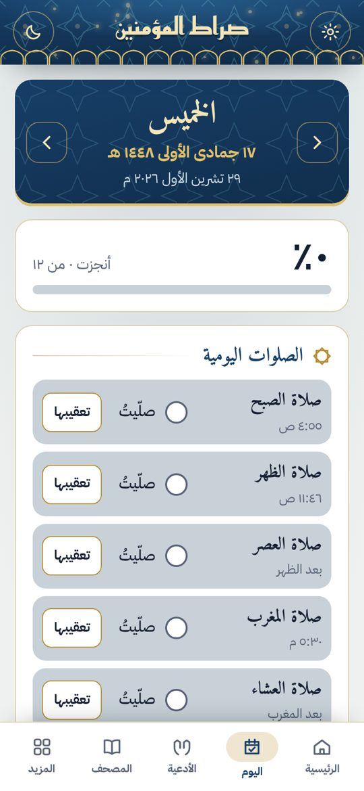

# صراط المؤمنين

عباداتك اليومية، والمصحف الشريف، وأوقات الصلاة، والزيارات والأدعية، في تطبيق واحد على أندرويد.

### [⬇️ تحميل التطبيق (APK)](https://github.com/Haidar-Hacking/Sirat-app/raw/main/sirat-almuminin.apk)

الإصدار **2.9.1** · لأندرويد 6 وأحدث · الحجم نحو 4 ميغابايت

## طريقة التثبيت

1. اضغط رابط **تحميل التطبيق** أعلاه من هاتف الأندرويد.
2. افتح الملف `sirat-almuminin.apk` بعد اكتمال التحميل.
3. إذا طلب الهاتف ذلك، اسمح بـ«تثبيت التطبيقات من هذا المصدر».
4. اضغط **تثبيت**.

إذا كانت عندك نسخة قديمة فثبّت الجديدة فوقها مباشرة، وستنتقل بياناتك تلقائياً.

> **إذا ظهرت رسالة من Play Protect:** اضغط «مزيد من التفاصيل» ثم «التثبيت على أي حال». التطبيق غير منشور على متجر Google Play، ولهذا قد يحذّر منه.

## ما في التطبيق

- **أعمال اليوم:** متابعة الصلوات والأذكار والأعمال اليومية، مع نسبة الإنجاز وأيام المواظبة.
- **المصحف الشريف:** قراءة كاملة مع البحث والعلامة والتلاوة الصوتية.
- **الزيارات والأدعية:** الزيارات، والأدعية (ومنها دعاء العشرات ودعاء يستشير)، والمناجاة، وأدعية الأيام، وأعمال الشهور، والتعقيبات العامة والخاصة بكل صلاة، والنوافل، وأعمال يوم الجمعة.
- **أوقات الصلاة:** حسب تقويم مكتب سماحة السيد السيستاني (دام ظله)، مع الإمساكية وجدول الشهر وتنبيه الأذان عند دخول الوقت.
- **القبلة والمسبحة والتقويم:** بوصلة القبلة، والمسبحة وتسبيح الزهراء (ع)، والتقويم الهجري والمناسبات، ومحوّل التاريخ.
- **الوضع العادي والمظلم،** ويعمل التطبيق بلا إنترنت (عدا التلاوة الصوتية).

## صور

## المصادر

نصوص الزيارات والأدعية من ويكي شيعة وويكي مصدر (رخصة CC BY-SA 4.0)، والأعمال من مفاتيح الجنان. التلاوات الصوتية من mp3quran.net وأرشيف الإنترنت، وصوت الأذان من تطبيق Shia Companion (رخصة MIT).

---

صنعه حيدر صادق

